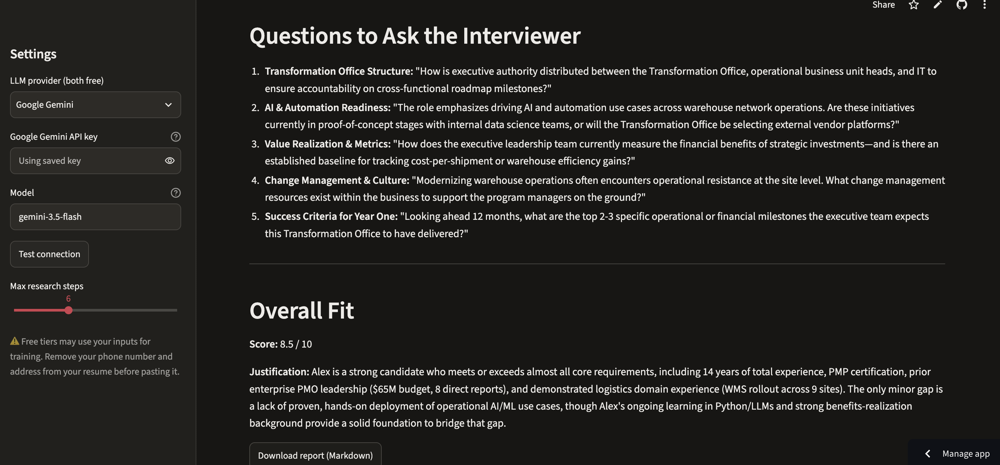

# 🔎 Job Posting Research Agent

An AI agent that prepares you for a job application. Give it a job posting and
your resume, and it **decides on its own** what to research: it reads the posting,
searches the web for company news and strategy, compares the role against your
experience, and writes an interview prep report.

**Live demo:** [Try it live](https://job-research-agent-8esy922xxei268vy5ga4wn.streamlit.app/) · **Cost to run:** $0



## What the report includes

- **Role snapshot**: what this role *really* cares about
- **Company briefing**: recent news, priorities and challenges, with sources
- **Fit analysis**: each requirement mapped to resume evidence (Strong / Partial / Gap)
- **Gaps**: and how to address them honestly
- **Talking points**: your best stories tied to the company's needs
- **Questions to ask**: grounded in the company research
- **Overall fit score**: 1–10 with justification

## How it works

```
            ┌──────────────────────────────────────────┐
            │                 LLM                      │
 posting ──►│ "Do I need more info? Which tool?"       │──► final report
 resume     └───────┬──────────────────────▲───────────┘
                    │ tool call            │ tool result
                    ▼                      │
            ┌───────────────┐   ┌──────────┴───────┐
            │  web_search   │   │  fetch_webpage   │
            │ (DuckDuckGo)  │   │ (requests + BS4) │
            └───────────────┘   └──────────────────┘
```

This is a **tool-calling agent loop**, written by hand in about 60 lines
([`agent/core.py`](agent/core.py)) with no framework, so every step is visible:

1. Send the conversation and tool descriptions to the LLM.
2. If the LLM requests a tool, run it, append the result, and repeat.
3. When the LLM replies with plain text, that's the final report.
4. A step limit prevents runaway loops and protects free-tier rate limits.

**Design choices**
- **Provider-agnostic, no SDK:** talks to Google Gemini or Groq through their
  OpenAI-compatible endpoints with a ~40-line HTTP client
  ([`agent/llm.py`](agent/llm.py)). Switching is a config change.
- **Never hangs:** every LLM call and search has a hard deadline, and a
  built-in connection test checks the key and compares models side by side.
- **Grounded output:** the prompt requires a source URL for every company fact
  and honest gap analysis. No invented experience.
- **Resilient tools:** tools return errors as text instead of crashing, so the agent
  can recover (e.g., if a job site blocks scraping, it tells the user to paste the text).
- **Tested without network:** unit tests use a fake LLM client, so they're fast and free.

## Tech stack

Python · Gemini/Groq via raw HTTP (`requests`) · Streamlit · DuckDuckGo Search ·
BeautifulSoup · pytest

## Run it locally

```bash
git clone https://github.com/gccodesai/job-research-agent.git
cd job-research-agent
python -m venv .venv
source .venv/bin/activate          # Windows: .venv\Scripts\activate
pip install -r requirements.txt

cp .env.example .env               # then paste a free API key into .env
streamlit run app.py               # opens in your browser
```

Get a free key (no credit card): [Google AI Studio](https://aistudio.google.com/apikey)
or [Groq](https://console.groq.com/keys).

Terminal version, using the included fictional samples:

```bash
python cli.py --job sample_data/sample_job.txt --resume sample_data/sample_resume.txt
```

Run the tests:

```bash
pytest
```

## Deploy for free (Streamlit Community Cloud)

1. Push this repo to GitHub (public).
2. Go to [share.streamlit.io](https://share.streamlit.io), sign in with GitHub,
   click **New app**, and pick this repo with `app.py` as the main file.
3. Under **Advanced settings → Secrets**, add:
   ```toml
   GEMINI_API_KEY = "your-key"
   ```
4. Deploy, then paste the link at the top of this README.

> **Tip:** To stop strangers from using up your free quota, delete the saved secret
> and let visitors paste their own key in the sidebar.

## Privacy note

Free LLM tiers may use inputs to improve their models. Remove personal details
(phone, address) from your resume before using it, and use only fictional data in demos.

## Project structure

```
agent/
  core.py      # the agent loop
  tools.py     # web_search, fetch_webpage + their schemas
  prompts.py   # system prompt and report format
  llm.py       # Gemini / Groq HTTP client + connection test
app.py         # Streamlit web interface
cli.py         # command-line interface
tests/         # unit tests with a fake LLM
sample_data/   # fictional job posting and resume
```

## Roadmap

- [x] Deploy to Streamlit Community Cloud
- [ ] Compare several postings side by side and rank by fit
- [ ] Draft a tailored cover letter from the report
- [ ] Save past reports and track applications
- [ ] Rebuild the loop in LangGraph and compare the two approaches

## What I learned

_Write 3–5 bullets here as you build: what was hard, what surprised you, what
you'd change. Hiring managers read this section._

## License

MIT
